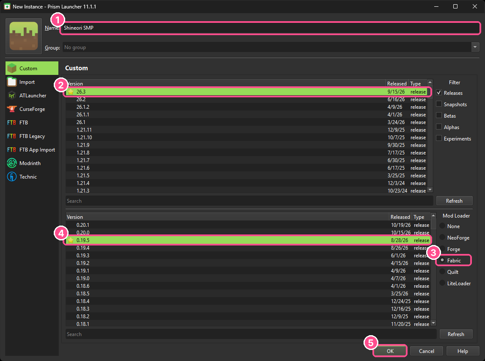
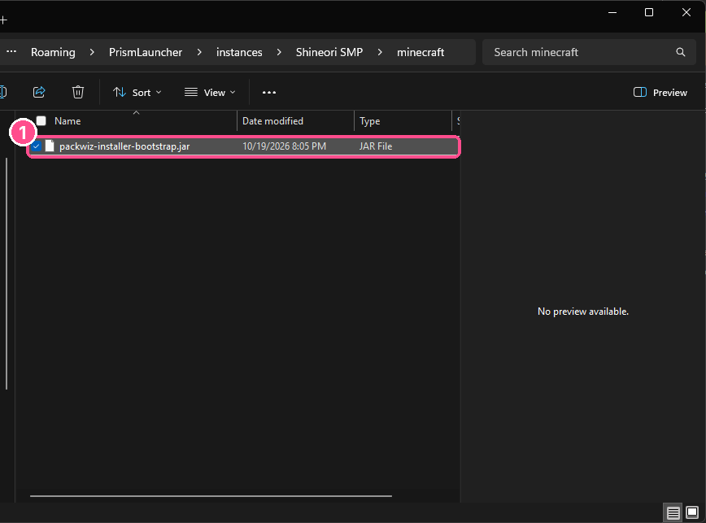
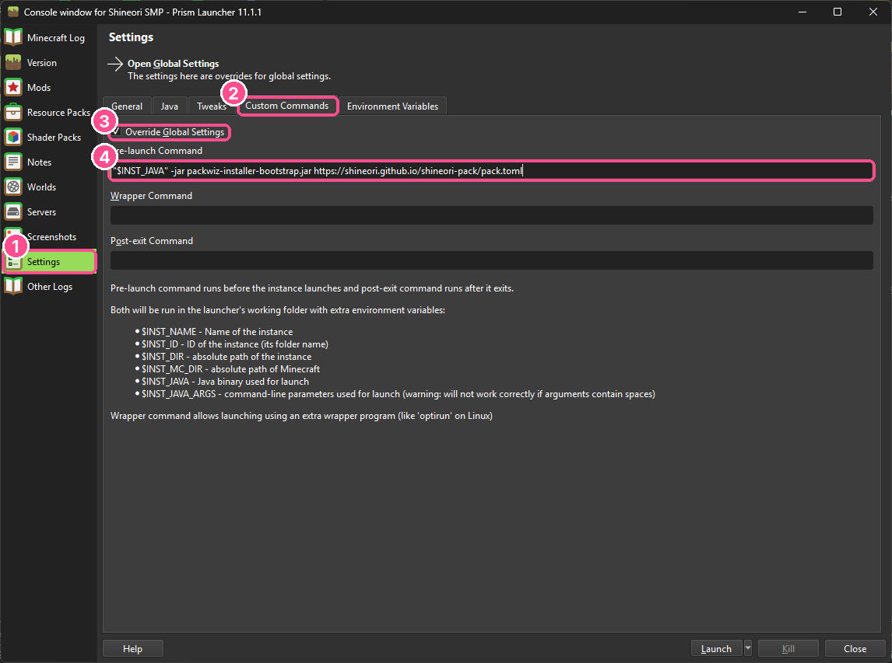
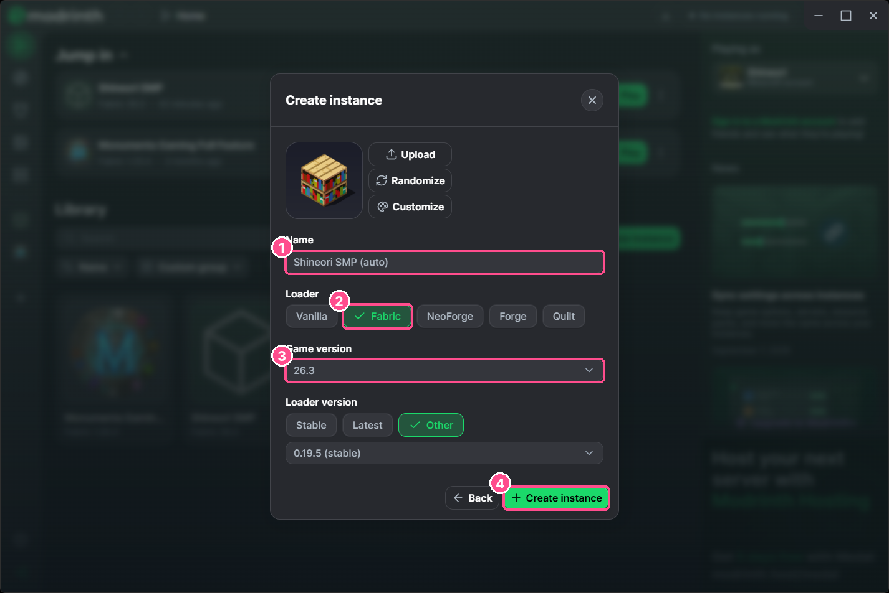
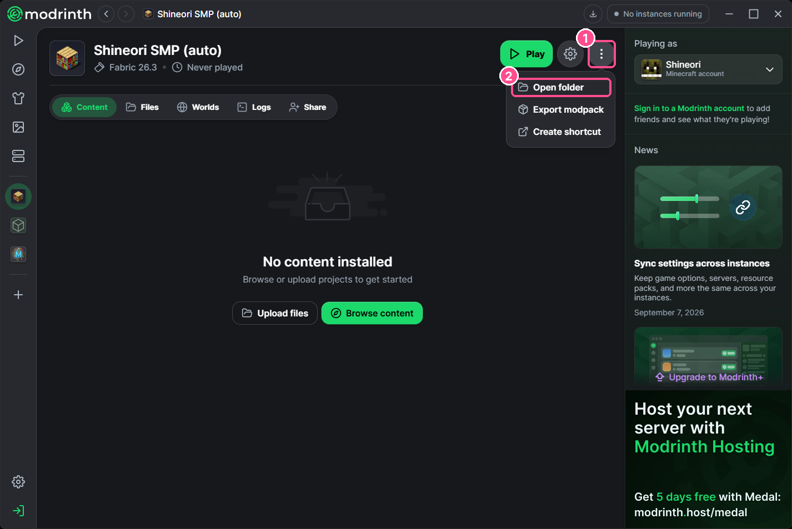
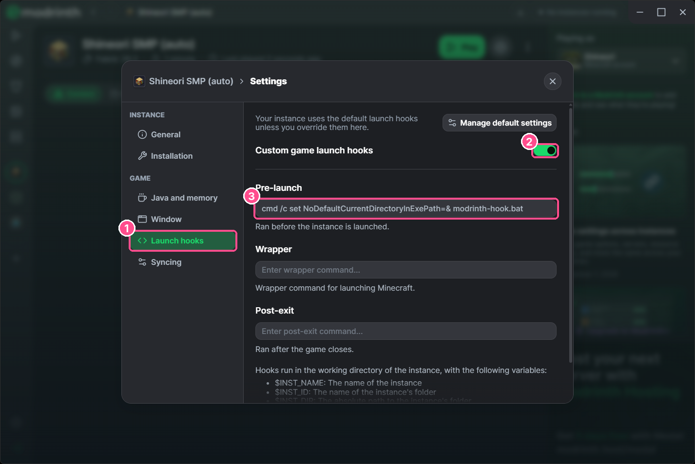

# Shineori SMP Modpack

Client modpack for **play.shineori.me** (Fabric, Minecraft 26.3).
Set it up once and your mods update themselves whenever the pack changes.

### 👉 Visual setup guide: https://shineori.github.io/shineori-pack/

**Pack link:** `https://shineori.github.io/shineori-pack/pack.toml`

> Don't want mods? You can still join with plain vanilla Minecraft. The pack just adds the minimap, JEI, textures and QoL stuff.

---

## 🟣 Prism Launcher (fully automatic, recommended)

1. **Add Instance**: Minecraft **26.3**, mod loader **Fabric**, version **0.19.5**.

   

2. Download [`packwiz-installer-bootstrap.jar`](https://shineori.github.io/shineori-pack/kit/packwiz-installer-bootstrap.jar). Click the instance, **Folder**, and put the jar inside the `minecraft` folder.

   

3. **Edit** › **Settings** › **Custom Commands**, tick **Override Global Settings**, paste into **Pre-launch Command**:
   ```
   "$INST_JAVA" -jar packwiz-installer-bootstrap.jar https://shineori.github.io/shineori-pack/pack.toml
   ```
   

4. Hit **Launch**. Every launch checks for updates automatically.

## 🟢 Modrinth App (fully automatic)

1. **+ New instance** › **Custom setup** › **Fabric**, **26.3**, **Create instance**.

   

2. Download [`shineori-sync.zip`](https://shineori.github.io/shineori-pack/kit/shineori-sync.zip). On the instance page: **⋮** › **Open folder**, unzip it there.

   

3. **⚙** › **Launch hooks**, turn on **Custom game launch hooks**, paste into **Pre-launch** exactly:
   ```
   cmd /c set NoDefaultCurrentDirectoryInExePath=& modrinth-hook.bat
   ```
   (Modrinth blocks running scripts from the instance folder by default; the first half turns that off for this one command.)

   

4. Hit **Play**. No Java install needed, it uses Modrinth's.

## 🟠 CurseForge app / Vanilla launcher (one double-click)

1. Make a Fabric 26.3 profile (CurseForge: Create Custom Profile; Vanilla: run the Fabric installer).
2. Download [`shineori-sync.zip`](https://shineori.github.io/shineori-pack/kit/shineori-sync.zip) and unzip it into the profile folder (the one with `mods` in it).
3. Double-click **`update-shineori.bat`** before you play. It uses your launcher's bundled Java; if it can't find one, install Java 21+ from [adoptium.net](https://adoptium.net).

## 📦 Manual fallback

Grab the latest `.mrpack` or CurseForge `.zip` from Hasaam in Discord.

---

### For Hasaam: updating the pack
```
packwiz modrinth add <mod>
packwiz refresh
git add -A && git commit -m "add <mod>" && git push
```
Bump `version` in `pack.toml` when you feel like it. Friends get changes on next launch.
